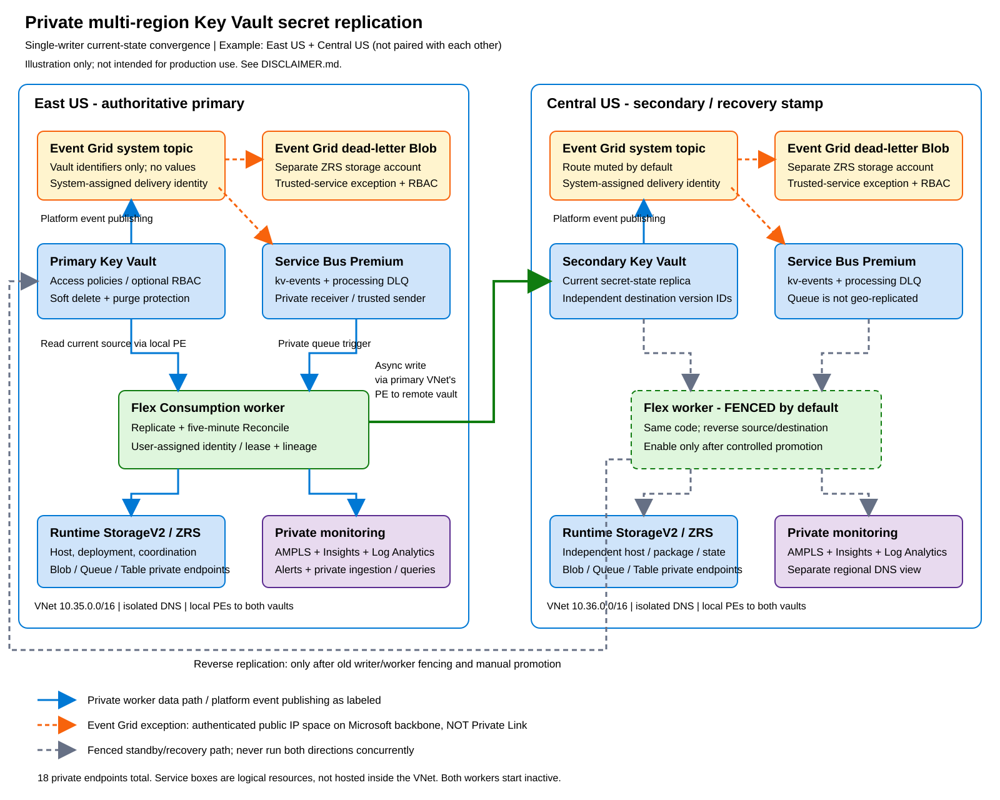

# Private multi-region Key Vault secret replication

An original Bicep and Python implementation of asynchronous **current-secret-state
convergence** between independent Key Vaults in **East US** and **Central US**.
These regions are not paired with each other. Each retains its own Azure-managed
regional resiliency; this solution adds customer-controlled cross-region replication.

## Sample code disclaimer

Sample Code is provided for the purpose of illustration only and is not intended to be used in a production environment. THIS SAMPLE CODE AND ANY RELATED INFORMATION ARE PROVIDED "AS IS" WITHOUT WARRANTY OF ANY KIND, EITHER EXPRESSED OR IMPLIED, INCLUDING BUT NOT LIMITED TO THE IMPLIED WARRANTIES OF MERCHANTABILITY AND/OR FITNESS FOR A PARTICULAR PURPOSE. We grant You a nonexclusive, royalty-free right to use and modify the Sample Code and to reproduce and distribute the object code form of the Sample Code, provided that. You agree: (i) to not use Our name, logo, or trademarks to market Your software product in which the Sample Code is embedded; (ii) to include a valid copyright notice on Your software product in which the Sample Code is embedded; and (iii) to indemnify, hold harmless, and defend Us and Our suppliers from and against any claims or lawsuits, including attorneys’ fees, that arise or result from the use or distribution of the Sample Code

The same notice is available in [DISCLAIMER.md](DISCLAIMER.md).

## Architecture diagram



[Architecture details and flow diagram](docs/architecture.md#solution-diagram) |
[Editable Excalidraw source](docs/images/architecture.excalidraw)
(open in [Microsoft Excalidraw](https://aka.ms/excalidraw)).

## Deployment paths

- [Bicep deployment](docs/deployment-bicep.md): subscription-scope deployment,
  private code publication, activation, and acceptance checks.
- [Azure Portal deployment](docs/deployment-portal.md): manually reproduce the
  same infrastructure and identity configuration without Bicep.
- [Architecture and limitations](docs/architecture.md).
- [Operating, promoting, and recovering](docs/operations.md).
- [Troubleshooting](docs/troubleshooting.md).
- [Approved decisions](docs/architecture-decisions.md) and [Microsoft references](docs/references.md).
- [Local validation and scanner dispositions](docs/validation.md).

## What this implements

| Area | Configuration |
| --- | --- |
| Compute | Two Linux Python 3.12 Flex Consumption apps |
| Authority | One writer at a time; manually fenced promotion/failback |
| Replication | Current secret value, content type, supported dates, enabled state, and user tags |
| Recovery | Initial/periodic reconciliation every five minutes; retry-safe lineage |
| Networking | Isolated VNets, local endpoints to both vaults, private storage/messaging/app access |
| Telemetry | Regional Log Analytics/Application Insights and private-only AMPLS |
| Identity | Managed identities; RBAC; storage shared keys and Service Bus local authentication disabled |

**Not every hop uses Private Link.** Event Grid push delivery uses a system-assigned
identity and trusted-service exception on the Microsoft backbone. Event Grid
dead-letter writes use a similar explicit exception. No replicated secret value
is placed into an event, coordination blob, or application log.

Both workers and event routes start inactive. Publishing code does not enable
replication. Activation is an explicit deployment/configuration step.

## Demo objectives, not guarantees

The example targets up to 100 secrets and 10 updates/minute, healthy event-driven
convergence within 60 seconds, and manually controlled recovery within 30 minutes.
Reconciliation runs every five minutes and therefore does **not** meet a
60-second objective for metadata-only changes or missed events. Asynchronous
replication has nonzero, unbounded-under-outage RPO.

This repository has local validation, not a completed Azure deployment exercise.
Regional quota, subscription policy, startup, private publication, telemetry,
Portal parity, and recovery objectives require live validation. Such validation
does not change the sample-only, non-production scope stated above.

## Local checks

Use PowerShell from the repository root:

```powershell
python -m venv .venv
.\.venv\Scripts\python.exe -m pip install -r .\src\replication\requirements.txt
.\.venv\Scripts\python.exe -m unittest discover -s .\tests\unit -v
az bicep build --file .\infra\main.bicep --outfile .\.build\main.json
az bicep build-params --file .\infra\parameters\example.bicepparam --outfile .\.build\parameters.json
```

Create `.build` first if it does not exist. No Azure credentials are needed for
unit tests or Bicep compilation. The smoke test is opt-in and creates retained
synthetic secrets; it never deletes them automatically.

## Provenance

Architectural inspiration:
[jclem2000/KeyVault-MultiRegion-Replication-Private](https://github.com/jclem2000/KeyVault-MultiRegion-Replication-Private).
The nested upstream clone is unchanged and excluded from this repository's Git
tracking. Its Python, Terraform, documentation, ZIP, and diagrams are not copied.
Use and distribution are subject to the [sample code disclaimer](DISCLAIMER.md).

Azure deployment, remote GitHub repository creation, commits, and pushing are
separate actions and are not performed by creating these local files.
