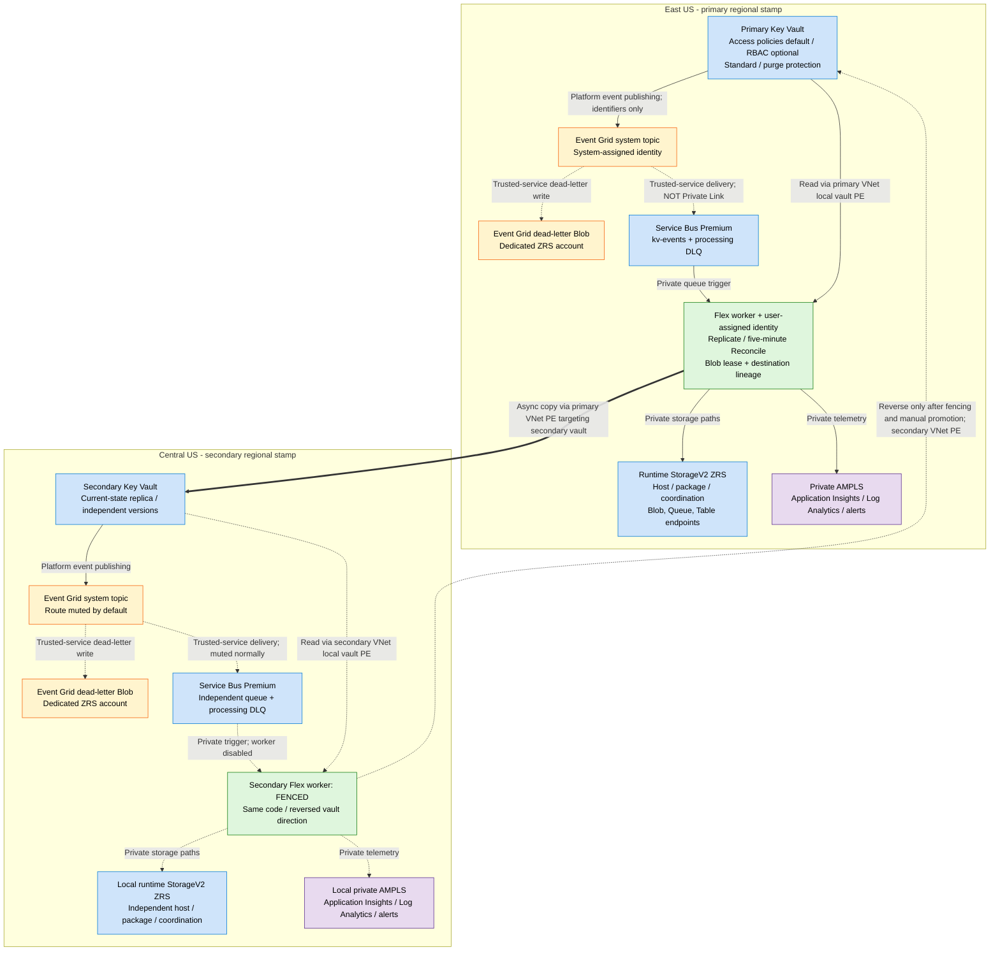

# Architecture

**Illustration only; not intended for production use.** This sample architecture
is subject to the [sample code disclaimer](../DISCLAIMER.md).

## Solution diagram

[Download the editable Excalidraw source](images/architecture.excalidraw) and open
it in [Microsoft Excalidraw](https://aka.ms/excalidraw). The diagram uses the
published East US/Central US example; deployment-specific region overrides do
not change the logical topology.

The following GitHub-rendered flow shows the same logical services. Regional
boxes are **not** VNet boundaries: PaaS services remain Azure-managed resources,
accessed through endpoints in each region's VNet.

**Important boundaries:** both workers initially start inactive; after activation,
only the authoritative worker runs. Both VNets have local endpoints to both
vaults, so no inter-region VNet peering is required. Event Grid push/dead-letter
delivery uses managed identity and trusted-service exceptions, not Private Link.
Private application/SCM publication requires a connected workstation or runner;
ARM/Entra management traffic is separate. Client application redirection and
writer fencing are operational actions, not automatic DNS failover.

## Independent regional stamps

Each depicted vault may instead be an existing same-subscription vault in another
resource group. [Existing-vault integration](existing-vaults.md) preserves its
configuration and existing topic/diagnostic integrations. The Private Link
topology is unchanged; configured regional locations must match the selected vaults.

| Resource | East US | Central US |
| --- | --- | --- |
| VNet | `10.35.0.0/16` | `10.36.0.0/16` |
| Functions integration | `10.35.1.0/24` | `10.36.1.0/24` |
| Private endpoints | `10.35.0.0/24` | `10.36.0.0/24` |
| Local vault role | Authoritative by default | Replica by default |
| Worker | Enabled only after activation | Fenced by default |
| Storage | Local StorageV2 ZRS | Local StorageV2 ZRS |
| Messaging | Local Service Bus Premium | Local Service Bus Premium |
| Monitoring | Local workspace/Insights/AMPLS | Local workspace/Insights/AMPLS |

Each stamp has private endpoints for both vaults, runtime Blob/Queue/Table,
local Service Bus, the Function App, dead-letter Blob, and Azure Monitor.
There are nine endpoints per stamp, 18 total. AMPLS allocates several IP addresses
within its endpoint; subnet sizing must accommodate them.

Private endpoints live in the VNet's region even when the target vault is remote.
No regional peering is necessary for the replication data path. A local endpoint
to a remote vault does not make that remote service available during its outage.

## Paths and trust boundaries

| Path | Networking | Identity |
| --- | --- | --- |
| Vault publishes version/expiry event | Azure platform integration | Azure service |
| Event Grid to Service Bus | Public endpoint IP space on Microsoft backbone; trusted-service bypass | System-assigned system-topic identity |
| Event Grid dead-letter write | Trusted-service Storage exception, not Private Link | Same system-topic identity |
| Worker receives messages | Local Service Bus private endpoint | Regional user-assigned worker identity |
| Worker reads/writes secrets | Local private endpoints targeting both vaults | Regional user-assigned identity; per-vault access policies or RBAC |
| Host/package/coordination/diagnostics storage | Local service-specific private endpoints | Regional user-assigned worker identity |
| Worker telemetry | Local AMPLS endpoint | Monitoring Metrics Publisher and Entra ingestion |
| Infrastructure management | ARM/Entra public management endpoints | Operator deployment identity |
| Code publication | App private deployment endpoint | Authorized publishing identity |

Private DNS and authorization are independent. Successful DNS resolution does
not demonstrate permission; a role or policy grant does not establish network access.
Private endpoints do not disable public endpoints automatically.

## Resource and permission details

Solution-managed Key Vault has Standard SKU, access policies by default (RBAC
optional per vault), public network access disabled, no trusted
service bypass, soft delete, and 90-day purge protection. VM deployment, disk
encryption, and ARM secret retrieval switches are off because this workload
does not need them.
Reused vaults retain their detected model; policy/RBAC mixed pairs are supported.
Microsoft supports both models but recommends RBAC for separation of duties.
Vault-write principals can grant themselves data access under policies; this
sample uses the access-policy default for compatibility rather than hiding that tradeoff.

Worker identity permissions:

- Local source vault: secret Get/List policy or Key Vault Secrets User role.
- Opposite destination vault: secret Get/List/Set policy or Custom Secret Replica
  Writer role (metadata/get/set/attribute update). Policy Set includes attribute
  updates. Neither branch grants key/certificate or delete/purge/backup/restore rights.
- Data Receiver on the local queue, not both namespaces.
- Blob Data Owner on runtime storage (host, deployment, coordination).
- Table Data Contributor on runtime storage for host diagnostic events.
- Monitoring Metrics Publisher on local Application Insights.

The reverse worker has its corresponding grants in advance but remains fenced.
Both identities are available before managed vaults, allowing complete worker
policy lists on every managed-vault PUT. The template owns these managed lists;
unrelated external grants require existing-vault reference mode to be preserved.
Reused policy-based vaults receive one additive policy request containing both
worker object/principal IDs, without a parent-vault PUT or whole-list replacement.
Role assignments and the custom role are conditional on effective RBAC use.
The worker SDK/authentication is unchanged; non-vault services still use RBAC.

Each worker may use an independently selected precreated user-assigned identity;
its resource group/name is not constrained to the regional stamp. In
[external-permissions mode](deployment-contributor.md), administrators precreate
both workers, vaults, and system topics and own every grant. Contributor operators
deploy the remaining infrastructure without role definitions/assignments or
vault policy writes. Identity attachment and ordinary deployment permissions
still apply. Event Grid continues using separate system-topic system identities.

An optional [delegated provisioning path](deployment-delegated.md) instead runs
identity/principal-bearing bootstrap and scoped grant templates inside keyless
short-lived ACI jobs using a third, administrator-precreated provisioning UAMI.
Ordinary infrastructure remains under the Contributor caller. Each phase is
previewed directly and task completion is independently confirmed; container
creation is not deployment completion. This management-plane path does not alter
the replication data flow or attach the provisioning identity to the Functions.

Deployment modules exchange deterministic ARM IDs instead of runtime module
outputs. The runner discovers existing-vault model/tenant/URI before preview and
preserves prior vault role-assignment names through read-only IAM inventory when
RBAC is in use and permissions are template-managed. Selected existing-worker
principal/client IDs are discovered before preview; new-worker identity values
and the Insights connection string are resolved inside resource properties.
Explicit dependencies retain actual
deployment order. This avoids the known cross-module what-if short-circuiting
pattern without requiring users to edit templates or deploy identities first.
The runner rejects incomplete preview coverage rather than treating CLI exit 0
as sufficient approval.

No queue storage binding uses the runtime Queue endpoint today. The account
supports it and the private endpoint is provisioned for host compatibility;
no speculative Queue Data Contributor role is assigned.

Event Grid identity permissions:

- Service Bus Data Sender on its local namespace.
- Blob Data Contributor on dedicated dead-letter storage.
- No Key Vault reader/secret permission.

Runtime storage has no trusted-service bypass. Separate dead-letter storage
has the documented AzureServices bypass and managed-identity access. Neither
allows shared keys or anonymous blob access.

## Current-state convergence

Events contain identifiers, not secret values. The worker validates the configured
source ARM ID, vault name, object type, secret ID/name/version, schema, and event
timestamp before processing any member of the message.

An event is a notification to synchronize **current authority**, not a command
to replay an old version. Per-secret Blob leases serialize local replicas across
instances and between event processing and reconciliation. Leases renew while
work runs and expire after a crash. They do not form an atomic transaction with
Key Vault and are not a global leader-election mechanism.

Destination tags record source ARM ID, source version, and a metadata fingerprint.
On retry after a destination write, the marker check avoids an extra version even
if recording coordination state failed. Blob state contains version IDs only.
Secret values are never logged or serialized to coordination storage.

New destination versions use local Key Vault version IDs. Versioned source
secret URLs are not valid on the replica. Applications should use the configured
vault URI and an appropriate version-independent secret reference.

The worker copies value, content type, not-before/expiry dates, enabled state,
and user tags for selected readable current secrets. Name allowlists and prefixes
apply to events and reconciliation, including destination-only alerts. Selecting
all secrets from a reused vault requires explicit opt-in. An unmanaged destination
name collision raises an error without overwriting or disabling it unless the
operator explicitly approves replacement for the selected names.

For disabled, expired, or future
secrets, it disables an existing destination rather than publishing unavailable
material. If no replica exists, it reports `source_inactive`; the value cannot
be backfilled until it is readable. Source deletion is reported, not propagated.
Reconciliation reports destination-only secrets for manual review.

The system does not compare or overwrite every manually edited replica value:
lineage assumes exclusive writes to the destination. Restrict writers accordingly.
Source lineage from a previous promotion is stripped before assigning new lineage.
Ordinary editors must not use `mrkv_` tags.

## Failure behavior

| Failure | Behavior |
| --- | --- |
| Invalid or foreign event | Raise; Service Bus retries then DLQ |
| Temporary Key Vault/Storage failure | SDK retries, then message retry/DLQ |
| Concurrent secret processing | Lease contention raises; retries and reconciliation recover |
| Lease loss | Stop before subsequent writes; report failure |
| Crash after destination write | Destination lineage recognizes completed write on retry |
| Source changes during a copy | Next event/reconciliation converges; no atomic source snapshot |
| Expiration or near-expiry event | Structured warning and scheduled alert; no rotation |
| Event Grid cannot reach queue | Delivery retry/dead-letter policy; delivery-failure alert |
| Destination-only object | Warning; never delete/purge automatically |
| Source region fails before replication | Latest unreplicated state may be unavailable |

Event Grid retry retention is up to 24 hours/30 attempts; the queue has 14-day
TTL and maximum delivery count 10. Service Bus DLQ is distinct from Event Grid
Blob dead-letter storage. Replaying either requires reviewing current authority.

## Cost and production boundaries

Two Premium Service Bus namespaces dominate fixed cost. Always-ready Flex
instances, 18 endpoints, ZRS storage, ingestion, alerts, and private deployment
connectivity also cost money. No June-2024 upstream price estimates are reused.
Use current regional Azure pricing before deployment.

Replication is not backup: it can copy erroneous values. Independent recovery,
application failover logic, operator access control, and incident-response
procedures remain necessary. Keys, certificates, full vault configuration,
historical versions, and cross-tenant deployment are outside the implementation.
